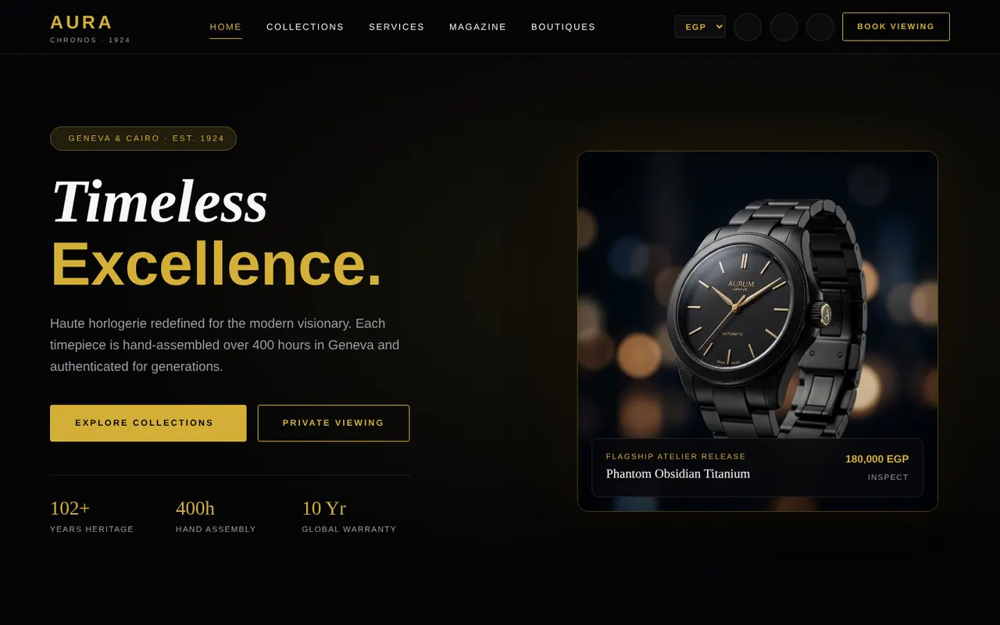

# AURA Chronos

Haute-horlogerie e-commerce boutique for luxury timepieces.

**Live demo:** https://watchesaura.surge.sh



## Features

- Collections and product detail pages
- Cart, wishlist and currency switcher (EGP)
- Checkout flow
- Private viewing booking and services page
- Global boutiques and a magazine section

## Tech stack

HTML5 · CSS3 · Vanilla JavaScript

## Run it locally

No build step — open `index.html` in a browser, or serve the folder:

```bash
npx serve .
```

---

Built by [Seif Sarhan](https://seifsarhan.github.io) · [GitHub](https://github.com/seifsarhan)
